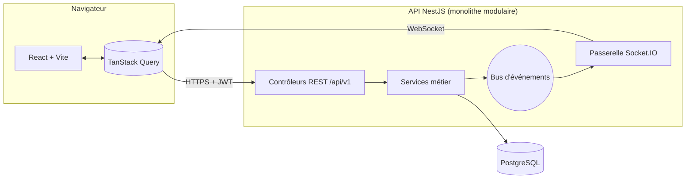
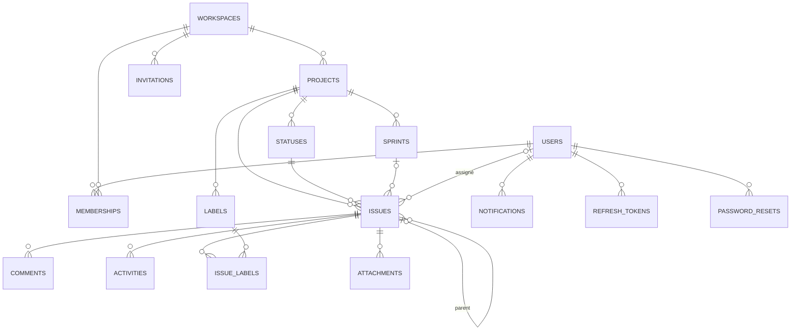

# Architecture

## Vue d'ensemble



Le dépôt est un monorepo pnpm de trois paquets : `apps/api`, `apps/web` et `packages/shared`. Ce dernier porte le contrat d'API (schémas Zod, types des réponses, hiérarchie des rôles). L'API valide les entrées avec ces schémas, le front type ses appels avec les mêmes : un champ renommé casse la compilation des deux côtés au lieu de casser la production.

## Décisions structurantes

### Monolithe modulaire plutôt que microservices
Un seul processus, découpé en modules NestJS par domaine (`auth`, `workspaces`, `projects`, `issues`, `sprints`, `comments`, `attachments`, `notifications`, `mail`, `realtime`). Chaque module expose un service ; les dépendances entre modules passent par les imports NestJS, donc restent visibles. Pour une équipe et un produit de cette taille, des microservices ajouteraient du réseau, du déploiement et des transactions distribuées sans rien résoudre. Si un domaine doit sortir un jour (les notifications, par exemple), la frontière existe déjà.

### PostgreSQL et Drizzle ORM
Le modèle est relationnel (un ticket appartient à un projet, qui appartient à un espace) et demande des transactions : PostgreSQL s'impose. Drizzle a été préféré à Prisma parce qu'il reste proche du SQL, n'embarque aucun moteur binaire, et génère des migrations SQL lisibles, relues et versionnées dans `apps/api/drizzle`.

### Contrôle d'accès à un seul endroit
Tout passe par `AccessService` : `workspace()`, `project()` et `issue()` chargent la ressource *et* le rôle de l'utilisateur dans la même requête. Une ressource hors de portée répond 404 et non 403, pour ne pas révéler son existence. Les identifiants reçus du client (assigné, sprint, parent, étiquettes) sont revérifiés contre le projet avant écriture.

### Classement des cartes par index fractionnaire
Chaque ticket a un `rank` textuel. Déplacer une carte calcule une clé entre ses deux voisines : une seule ligne est écrite, quelle que soit la taille de la colonne, et deux déplacements simultanés ne se bloquent pas. La colonne est en collation `"C"` pour que PostgreSQL trie comme JavaScript. Le front fait le même calcul pour la mise à jour optimiste, donc la carte ne saute pas à la réponse du serveur.

### Temps réel découplé du métier
Les services publient des événements (`issue.moved`, `comment.created`…) sur un bus interne. La passerelle Socket.IO les écoute et les diffuse dans la salle `project:<id>`, après avoir vérifié à l'abonnement que l'utilisateur a accès au projet. Les services ne connaissent pas le transport : passer à plusieurs instances revient à brancher l'adaptateur Redis de Socket.IO.

### Authentification
- Jeton d'accès JWT de 15 minutes, gardé en mémoire côté front (jamais dans `localStorage`).
- Jeton de rafraîchissement aléatoire, stocké haché en base, envoyé en cookie `httpOnly`, `SameSite=Lax`, limité au chemin `/api/v1/auth`.
- Rotation à chaque rafraîchissement. Les jetons d'une même connexion forment une famille : si un jeton déjà utilisé revient, toute la famille est révoquée.
- Le front et l'API sont servis sous la même origine (proxy Vite en développement, reverse proxy en production), ce qui évite CORS et les cookies tiers.

### Jetons à usage unique
Liens de réinitialisation du mot de passe et d'invitation : un jeton aléatoire de 256 bits part par e-mail, seule son empreinte SHA-256 est stockée. Une fuite de la base ne donne donc aucun lien utilisable. Le lien d'invitation est lié à l'adresse invitée ; changer de mot de passe révoque toutes les sessions ouvertes.

### E-mails et fichiers derrière une interface
`MailService` envoie par SMTP si `SMTP_URL` est défini, sinon écrit l'e-mail dans les journaux (pratique en développement, et c'est ce que lisent les tests de bout en bout). `StorageService` range les pièces jointes sur disque sous un nom opaque. Passer à un service d'envoi ou à S3 ne touche que ces deux classes.

Les pièces jointes sont toujours servies en `Content-Disposition: attachment` avec un type `application/octet-stream` : un fichier HTML ou SVG déposé par un membre ne peut pas s'exécuter dans l'origine de l'application avec la session d'un autre.

### État côté front
- **TanStack Query** pour tout ce qui vient du serveur (cache, invalidation, mises à jour optimistes).
- **Zustand** pour le peu d'état local durable : session et espace courant.
- **L'URL** pour ce qui doit se partager : projet, vue, ticket ouvert (`?issue=`).
- Chaque page est un morceau de bundle chargé à la demande ; le rendu Markdown (le plus lourd) n'est chargé qu'à l'ouverture d'un ticket.

## Modèle de données



Points à connaître :
- `projects.issue_counter` est incrémenté dans la transaction de création du ticket : les numéros sont uniques sans verrou de table.
- `statuses.category` (backlog, à faire, en cours, terminé, annulé) donne un sens aux colonnes, quel que soit leur nom. C'est ce qui permet de calculer l'avancement d'un sprint ou « mes tickets ouverts ».
- Les suppressions se propagent par clés étrangères (`ON DELETE CASCADE` ou `SET NULL`).

Le schéma complet est dans `apps/api/src/database/schema.ts`.

## API REST

Préfixe `/api/v1`. Toutes les routes exigent un jeton d'accès, sauf `auth/*` et `health`.

| Domaine | Routes |
| --- | --- |
| Auth | `POST auth/register`, `POST auth/login`, `POST auth/refresh`, `POST auth/logout`, `GET/PATCH auth/me`, `POST auth/password`, `POST auth/forgot-password`, `POST auth/reset-password` |
| Espaces | `GET/POST workspaces`, `PATCH workspaces/:id`, `GET workspaces/:id/search?q=` |
| Membres | `GET/POST workspaces/:id/members`, `PATCH/DELETE workspaces/:id/members/:userId` |
| Invitations | `GET workspaces/:id/invitations`, `DELETE workspaces/:id/invitations/:invitationId`, `GET invitations/:token`, `POST invitations/:token/accept` |
| Projets | `GET/POST workspaces/:id/projects`, `GET/PATCH projects/:id`, `GET projects/:id/reports` |
| Colonnes, étiquettes | `POST projects/:id/statuses`, `PATCH/DELETE projects/:id/statuses/:statusId`, `POST projects/:id/labels`, `PATCH/DELETE projects/:id/labels/:labelId` |
| Tickets | `GET/POST projects/:id/issues`, `GET/PATCH/DELETE issues/:id`, `POST issues/:id/move`, `GET issues/:id/activity` |
| Commentaires | `GET/POST issues/:id/comments`, `PATCH/DELETE comments/:id` |
| Pièces jointes | `POST issues/:id/attachments` (multipart, champ `file`), `GET/DELETE attachments/:id` |
| Sprints | `POST projects/:id/sprints`, `PATCH/DELETE sprints/:id`, `POST sprints/:id/start`, `POST sprints/:id/complete` |
| Moi | `GET me/issues`, `GET me/notifications`, `POST me/notifications/read` |

Erreurs : `400` avec le détail par champ, `401`, `403` (rôle insuffisant), `404`, `409` (conflit métier, avec un message affichable), `413` (fichier trop gros), `429`.

WebSocket : événements `project:join` / `project:leave` vers le serveur ; `project:event` et `notification` vers le client.

## Sécurité

- Validation Zod de toutes les entrées, requêtes SQL paramétrées par Drizzle.
- `helmet`, limitation de débit globale et renforcée sur l'inscription et la connexion.
- Cloisonnement par espace de travail vérifié par les tests de bout en bout.
- Configuration validée au démarrage : l'API refuse de démarrer sans secret JWT d'au moins 32 caractères.

## Tests

- **API, unitaires** (Vitest) : hachage des mots de passe, calcul des rangs.
- **API, bout en bout** (`apps/api/test/smoke.e2e.mjs`) : 27 parcours contre une vraie base. Ils couvrent :
  - inscription, cloisonnement entre espaces, numérotation, déplacements ;
  - rôles, temps réel, sprints, colonnes, recherche ;
  - profil, changement et réinitialisation du mot de passe ;
  - invitations, gestion des membres, mentions ;
  - étiquettes, pièces jointes, rapports ;
  - rotation et rejeu des jetons.
- **Front** (Vitest + Testing Library) : formatage des dates et tailles, détection et rendu des mentions, graduations des graphiques, composant « voie du sprint », droits affichés sur la page Membres.
- **CI** : `.github/workflows/ci.yml` lance compilation, types, tests, parcours de bout en bout avec un PostgreSQL de service, puis construit les deux images Docker.

## Mise en production

`docker-compose.prod.yml` lance PostgreSQL, l'API et le front :

- **API** (`docker/api.Dockerfile`) :
  - applique les migrations à chaque démarrage, puis lance le serveur ;
  - garde les pièces jointes dans un volume.
- **Front** (`docker/web.Dockerfile`) :
  - nginx sert les fichiers statiques ;
  - il relaie `/api` et `/socket.io` vers l'API sous la même origine.

```bash
cp .env.prod.example .env.prod      # PUBLIC_URL, mots de passe, SMTP
docker compose -f docker-compose.prod.yml --env-file .env.prod up -d --build
```

Placez un reverse proxy HTTPS (Caddy, Traefik…) devant le port `WEB_PORT`. Le cookie de session passe en `Secure` dès que `PUBLIC_URL` commence par `https://`.
